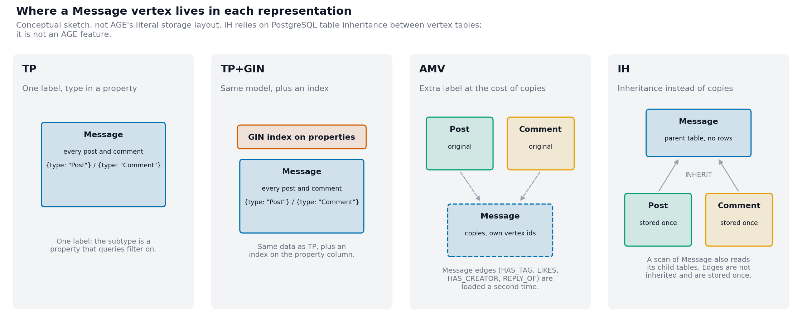
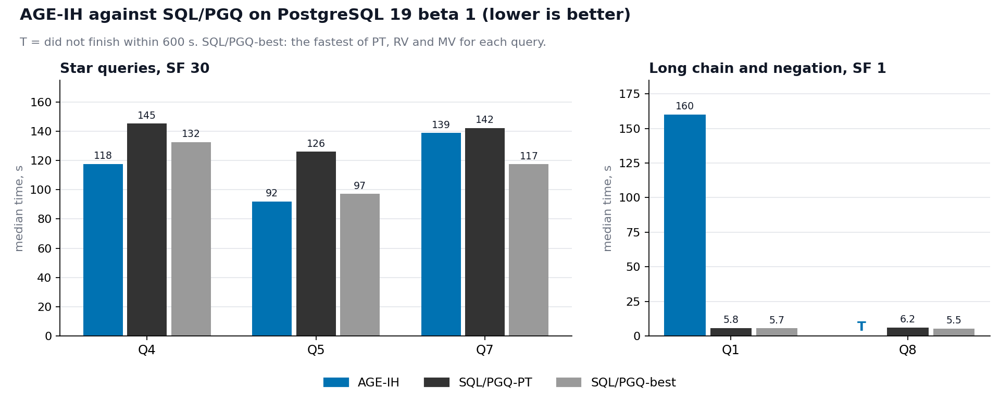
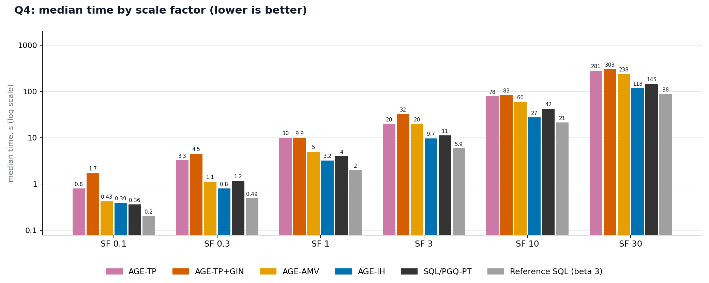
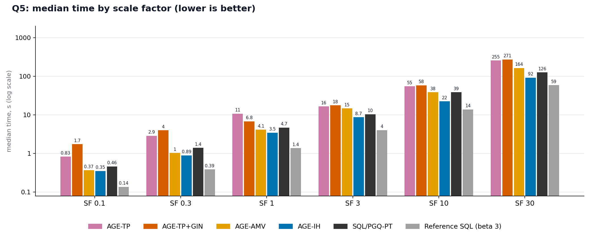
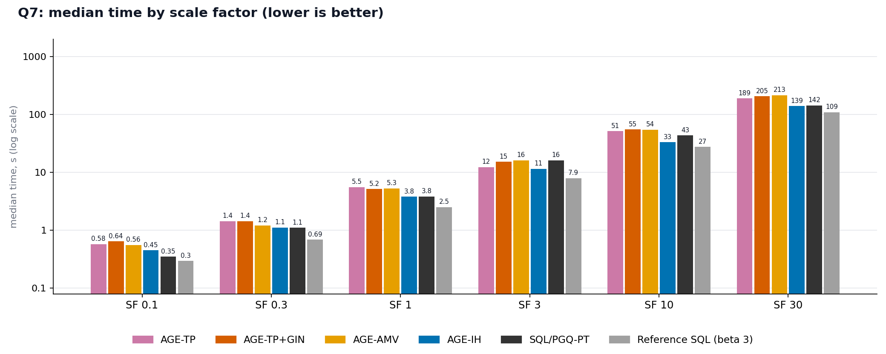
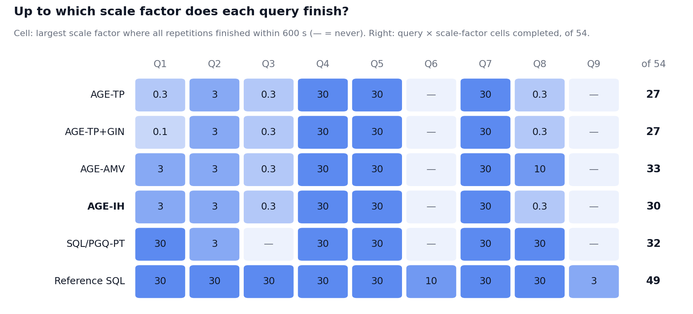
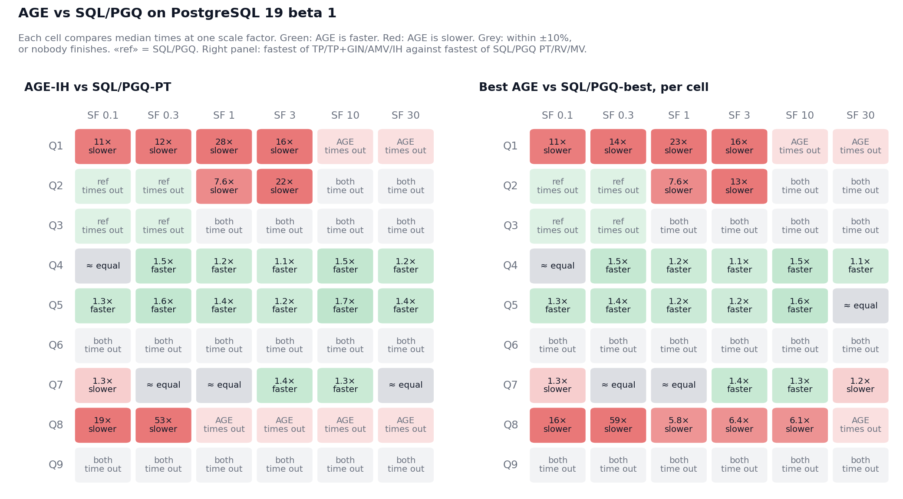

# Benchmarking Apache AGE on LSQB: Where It Wins and Where It Struggles

*By Dmitriy Eremeev, Ivan Khramkov and Aleksey Teplov · 12 October 2026*

Graph query performance depends on more than the database engine: how the data is stored, the shape of the
query and the plan the optimizer picks can each change the result dramatically.

We ran the nine queries of LDBC's Labelled Subgraph Query Benchmark ([LSQB](https://github.com/ldbc/lsqb))
on Apache AGE (PostgreSQL 19 beta 1) at six scale factors, SF 0.1 to 30 — at SF 30 that is about 103 million
vertices and 541 million edges — and compared them with the published SQL/PGQ results of the
[SQL/PGQ study](https://ldbcouncil.org/docs/papers/postgres-sql-pgq-benchmark-report.pdf). AGE has no multi-label vertices, so we tried four ways to represent LSQB's `Message`,
the supertype of `Comment` and `Post`, described below.

What we found:

- **Coverage is similar, but not the same.** Of the 54 query × SF cells, AGE-IH completes 30 and AGE-AMV 33
  within the 600 s timeout; SQL/PGQ completes 32.
- **Star-shaped queries are AGE's strong case.** With IH they reach SF 30 and, from SF 0.3 up, run as fast as
  SQL/PGQ on plain tables or faster.
- **Long chains, negative edges and undirected `knows` are its weak case**: an order of magnitude slower than
  SQL/PGQ, or no answer within ten minutes.
- **The representation matters more than the index.** IH has the lowest median on every star query at every
  size; the GIN index brings no overall gain.

Harness, queries, timings and every captured plan: [apache-age-lsqb-benchmark](https://github.com/atberium/apache-age-lsqb-benchmark/tree/776011f41447e875c6c7d097eaf9166f05757ea2).

## Four ways to represent `Message`



- **TP** (Type Property) — every post and comment in one `Message` label, with the subtype in a `type` property.
- **TP+GIN** — TP plus a GIN index on `properties`.
- **AMV** (Additional Message Vlabel) — `Comment` and `Post` labels, plus copies of every post and comment, and
  of their `HAS_TAG`, `LIKES`, `HAS_CREATOR` and `REPLY_OF` edges, under `Message`.
- **IH** (InHeritance) — each post and comment stored once, in `Comment` and `Post` tables that inherit from an
  empty `Message` table.

Schemas: [TP and TP+GIN](https://github.com/atberium/apache-age-lsqb-benchmark/blob/776011f41447e875c6c7d097eaf9166f05757ea2/queries/with-type-property/graph.sql) (the index is its [last line](https://github.com/atberium/apache-age-lsqb-benchmark/blob/776011f41447e875c6c7d097eaf9166f05757ea2/queries/with-type-property/graph.sql#L57)), [AMV](https://github.com/atberium/apache-age-lsqb-benchmark/blob/776011f41447e875c6c7d097eaf9166f05757ea2/queries/with-additional-message-vlabel/graph.sql), [IH](https://github.com/atberium/apache-age-lsqb-benchmark/blob/776011f41447e875c6c7d097eaf9166f05757ea2/queries/with-inheritance/graph.sql#L18-L19).

## Results

| Configuration | Cells completed, of 54 | What matters |
|---|---:|---|
| AGE-TP | 27 | Simplest model: one `Message` label, subtype as a property |
| AGE-TP+GIN | 27 | The index is used but brings no overall gain |
| AGE-AMV | 33 | Most completed cells among the AGE variants |
| AGE-IH | 30 | Fastest AGE variant on the star queries |
| SQL/PGQ-best | 32 | Fastest published SQL/PGQ storage strategy, chosen separately for each cell |
| Reference SQL | 49 | Different PostgreSQL version (beta 3) and layout — indicative only |



Each configuration was loaded once and each query run five times; the medians show one plan per
configuration, not variation between independent loads.

### Comparing the representations







**SF 1**, median seconds:

| Query | TP | TP+GIN | AMV | IH | Fastest (next slower by) |
|---|---:|---:|---:|---:|---|
| Q1 | — | — | 131 | 160 | AMV (IH 1.22×) |
| Q2 | 68 | 67 | 110 | 28 | IH (TP+GIN 2.36×) |
| Q4 | 10.1 | 9.9 | 5.0 | 3.2 | IH (AMV 1.55×) |
| Q5 | 10.8 | 6.8 | 4.1 | 3.5 | IH (AMV 1.20×) |
| Q7 | 5.5 | 5.2 | 5.3 | 3.8 | IH (TP+GIN 1.36×) |
| Q8 | — | — | 32 | — | AMV, the only one to finish |

**SF 30**, median seconds (Q1, Q2 and Q8 finish in no representation):

| Query | TP | TP+GIN | AMV | IH | Fastest (next slower by) |
|---|---:|---:|---:|---:|---|
| Q4 | 281 | 303 | 238 | 118 | IH (AMV 2.02×) |
| Q5 | 255 | 271 | 164 | 92 | IH (AMV 1.78×) |
| Q7 | 189 | 205 | 213 | 139 | IH (TP 1.36×) |

— means every repetition timed out; ratios compare point estimates, not statistical significance.

- **IH wins the star queries** at every size, by 1.08–2.17× over the next representation from SF 1 up, at
  about the disk cost of TP (77 GB against 76 GB at SF 30).
- **AMV pays for its copies**: 134 GB at SF 30, 1.7× IH's load time, and Q2 2.8–3.9× slower than on IH. It is
  the only representation that carries Q8 past SF 0.3, to SF 10.
- **The GIN index does not rescue TP.** It is used in every plan that filters on `type`, yet apart from one
  clear gain — Q5 at SF 1, 1.6× faster — TP+GIN is at most 14 % faster than TP and up to 2.2× slower (SF 0.1);
  on the star queries at SF 30 it is 1.06–1.08× slower. At SF 30 it adds 18 % to the database and 26 % to
  the load time.

## Comparison with SQL/PGQ





The references are the published campaign-2 results ([`beta1/pgq`](https://github.com/atberium/postgres-lsqb-benchmark/tree/e62ff5ec4243fded2d4e49c75437c6522bceb38f/runs/campaign-2-controlled/beta1/pgq),
[`beta3/sql`](https://github.com/atberium/postgres-lsqb-benchmark/tree/e62ff5ec4243fded2d4e49c75437c6522bceb38f/runs/campaign-2-controlled/beta3/sql)). Every comparison below mixes the engine, what the planner makes of each
engine's output and the physical layout, so it compares configurations, not technologies. The two SQL/PGQ
comparisons answer different questions and should not be merged into one claim about which engine is
faster.

**Like for like — AGE-IH against SQL/PGQ-PT**, same server and settings. The layouts still differ: AGE keeps
one table per label with `graphid` keys, `agtype` properties and `start_id`/`end_id` indexes; SQL/PGQ keeps
typed tables with `bigint` primary keys and no secondary indexes. From SF 0.3 up AGE-IH is level or faster on
the star queries — at SF 30 1.2× faster on Q4, 1.4× on Q5, level on Q7. Q1 is 11–28× slower, and Q8 stops at
SF 0.3 while SQL/PGQ reaches SF 30; at the two smallest sizes AGE completes Q2 and Q3, where SQL/PGQ times
out. Storage is the same, 77 GB at SF 30; AGE-IH loads 1.2–2.0× slower.

**Best against best — the fastest AGE representation against SQL/PGQ-best**, per cell. The star-query gap
narrows: at SF 30 AGE is 1.1× faster on Q4, level on Q5 and 1.2× slower on Q7, so much of IH's lead above
comes from SQL/PGQ's plain-table layout. Q1 is still 11–23× slower; Q8, carried by AMV, completes to SF 10 at
about 6× the SQL/PGQ time.

**Reference SQL on beta 3** gives a sense of scale only: it completes 49 cells and runs the star queries
1.3–1.6× faster than AGE-IH at SF 30.

## What the execution plans tell us

Plans were captured with `EXPLAIN` without `ANALYZE`, so they show estimates, not actual row counts; each
link points at the lines in the captured plan.

### TP misjudges its own type filter

`{type: 'Comment'}` becomes `properties @> '{"type": "Comment"}'`, and at SF 30 the planner expects about
100 thousand matching rows — exactly 0.1 % of 101 million messages — where the data holds about 77 million
comments ([plan](https://github.com/atberium/apache-age-lsqb-benchmark/blob/776011f41447e875c6c7d097eaf9166f05757ea2/runs/30-TP/30.TP.2026_10_08_02_17_20.result/q5.txt#L43-L45)). Every join above that scan is planned for a relation about 750 times
smaller than the real one. The GIN index changes the access path, not the estimate: 101 134 rows
([plan](https://github.com/atberium/apache-age-lsqb-benchmark/blob/776011f41447e875c6c7d097eaf9166f05757ea2/runs/30-TP-with-index/30.TP.with-index.2026_10_09_00_07_07.result/q5.txt#L43-L47)).

The results are consistent with this underestimate driving TP's deficit — 1.9–2.9× slower than IH on Q4 and
Q5 from SF 3 up, 2.0–3.3× with the index — but a causal claim would need a separate experiment.

### Undirected `KNOWS` becomes an `OR`

`(a)-[:KNOWS]-(b)` turns into an `OR` of two conjunctions, from which the planner derives no hashable
equality condition for the join. It uses nested loops with BitmapOr index probes instead — at SF 1 a
Person × Person loop of 121 million rows for Q6 ([plan](https://github.com/atberium/apache-age-lsqb-benchmark/blob/776011f41447e875c6c7d097eaf9166f05757ea2/runs/1-IH/1.IH.2026_10_08_02_16_42.result/q6.txt#L35), [the `OR`](https://github.com/atberium/apache-age-lsqb-benchmark/blob/776011f41447e875c6c7d097eaf9166f05757ea2/runs/1-IH/1.IH.2026_10_08_02_16_42.result/q6.txt#L44-L52)) —
so the work grows with the square of the number of persons. All four `knows` queries get this shape in every
representation at every size.

This is *likely* the main reason Q3, Q6 and Q9 stop early. Reference SQL avoids the shape by storing `knows`
in both directions and joining one way; we did not test that layout in AGE.

### `NOT EXISTS` is never turned into an anti-join

Q8's negative edge becomes a correlated SubPlan in AGE, wrapped in an `agtype` cast and run once per
candidate row ([join filter](https://github.com/atberium/apache-age-lsqb-benchmark/blob/776011f41447e875c6c7d097eaf9166f05757ea2/runs/1-IH/1.IH.2026_10_08_02_16_42.result/q8.txt#L14), [SubPlan](https://github.com/atberium/apache-age-lsqb-benchmark/blob/776011f41447e875c6c7d097eaf9166f05757ea2/runs/1-IH/1.IH.2026_10_08_02_16_42.result/q8.txt#L59-L63)); SQL/PGQ's
`LEFT JOIN … IS NULL` becomes a Hash Right Anti Join at every size ([plan](https://github.com/atberium/postgres-lsqb-benchmark/blob/e62ff5ec4243fded2d4e49c75437c6522bceb38f/runs/campaign-2-controlled/beta1/pgq/analyze/PT-sf1/q8.json#L88-L104)). From SF 1 up
AMV's SubPlan probes a single index instead of a BitmapAnd.

The SubPlan *likely* explains AGE's Q8 deficit, and the cheaper probe why AMV alone completes Q8 to SF 10;
neither has been isolated by measurement.

### Q1's gap is still unexplained

At SF 1 both AGE-IH and SQL/PGQ answer Q1 — a chain of eight vertices — with pure hash joins over the same 15
relations, yet AGE is 28× slower (11–28× across sizes); unlike the three cases above, the plan shape does not account for it.
Two hypotheses remain untested: the edge-uniqueness check AGE applies to each of 221 million result rows
([plan](https://github.com/atberium/apache-age-lsqb-benchmark/blob/776011f41447e875c6c7d097eaf9166f05757ea2/runs/1-IH/1.IH.2026_10_08_02_16_42.result/q1.txt#L27)), and mixed-type edge tables such as `REPLY_OF`, which hold replies to posts and
to comments together.

## Conclusion

Apache AGE can be a good fit for workloads dominated by star-shaped graph patterns, provided the data
representation is chosen carefully; in this benchmark inheritance was the best choice for those queries,
though not necessarily for every production schema. Long chains, negative edge patterns and undirected
many-to-many traversals remain significant bottlenecks in this implementation and configuration — not a
proven ceiling of the technology. And since performance here is a property of engine, query formulation,
physical layout and plan together, these results do not isolate the contribution of AGE itself.

## Experimental details and reproducibility

**Protocol.** Each configuration — one representation at one SF — ran on its own `8cpu-32ram` instance
(8 vCPU, 32 GiB, x86_64; the same flavour as the SQL/PGQ campaign): one load, one `ANALYZE VERBOSE`, then for
each query, Q1 to Q9, an estimate-only `EXPLAIN` followed by five runs, each in a new connection, with a
600 s `statement_timeout`, no server restart and no cache flush. A cell counts as completed only when all five
runs finish, and only then is a median reported. For queries over 5 s the first run was within 13 % of the
median of the other four, except a few Q1 runs on IH that were 1.5–1.6× slower — limited first-run bias,
though cache effects are not isolated. SF sizes are row-count estimates after `ANALYZE`: SF 1 is about
4 million vertices and 18 million edges.

| | |
|---|---|
| Image | [`apache/age:dev_snapshot_PG19`](https://hub.docker.com/layers/apache/age/dev_snapshot_PG19/images/sha256-db765e1bf2d486176ed9b354befd82c8b0c3739416af8d56015eed268c33c2dd), digest `sha256:db765e1bf2d486176ed9b354befd82c8b0c3739416af8d56015eed268c33c2dd`, on `postgres:19beta1` (Debian trixie) |
| AGE | 1.8.0, development snapshot from branch `PG19` at [`15a1f0d`](https://github.com/apache/age/commit/15a1f0d7f9d24ce9766b5430683d2d4d88c4a1a3)¹ |
| Server | `19~beta1-1.pgdg13+1`, packaged defaults: `shared_buffers` 128 MB, `work_mem` 4 MB, `effective_cache_size` 4 GB, 2 workers per gather (8 in all), `jit` off, `random_page_cost` 4, autovacuum on |
| Load | `graph.sql` via `psql`, `load_labels_from_file` / `load_edges_from_file`; load time is the wall-clock time of that call |
| Size | `pg_database_size` after loading, all objects included, binary units |

¹ Inferred, since the image has no source revision label: it was pushed after 20 August 2026, and `15a1f0d`,
the head of `PG19`, only fixed the Docker Hub build; the extension source is that of
[`d03d1cb`](https://github.com/apache/age/commit/d03d1cb07aab5919bb6b6019863143d0e46db024), AGE 1.8.0 on
PostgreSQL 19 beta 1.

**Data for TP.** Posts and comments both go into the `Message` label with the subtype as a property column;
the loader takes `id` as the vertex id and every other column as a property (ids illustrative; comments are
the same with `"Comment"`):

```
"id","type"
1099511627776,"Post"
1099511627777,"Post"
```

**IH and labels.** IH relies on PostgreSQL table inheritance between vertex tables, which AGE does not
document. In this build `MATCH (m:Message)` reads the empty parent and both child tables through an Append
([plan](https://github.com/atberium/apache-age-lsqb-benchmark/blob/776011f41447e875c6c7d097eaf9166f05757ea2/runs/1-IH/1.IH.2026_10_08_02_16_42.result/q4.txt#L62-L71)), and every count matches the other representations; other label-dependent
behaviour was not tested.

**References.** SQL/PGQ-PT and SQL/PGQ-best come from SQL/PGQ's storage strategies for the relations LSQB
derives from the source data — plain tables (PT), regular views (RV) and materialised views (MV); SQL/PGQ-best
takes the fastest per cell. Reference SQL was measured on beta 3 only and not re-run on beta 1; its layout
stores one-to-many edges as foreign-key columns, has no primary keys and stores `knows` in both directions.

**Correctness.** Every LSQB query returns a single count. In each of the 33 cells any AGE representation
completed, that count is the same across every AGE representation and every reference configuration that
completed it — SQL/PGQ and reference SQL, each with PT, RV and MV. At least one reference completed each of the
33, and the reference counts match LSQB's published answers ([SQL/PGQ report, §4.5](https://ldbcouncil.org/docs/papers/postgres-sql-pgq-benchmark-report.pdf#page=32)). Only the
counts were compared, not the matched subgraphs.

**Limitations.** The comparison inherits the conditions of the reference study — implementations rather than
query languages, different physical layouts and `knows` representations, untuned defaults — set out in its
[report](https://ldbcouncil.org/docs/papers/postgres-sql-pgq-benchmark-report.pdf): §3.2 ([p. 12](https://ldbcouncil.org/docs/papers/postgres-sql-pgq-benchmark-report.pdf#page=12)), §3.3 ([p. 14](https://ldbcouncil.org/docs/papers/postgres-sql-pgq-benchmark-report.pdf#page=14)), §3.5 ([p. 19](https://ldbcouncil.org/docs/papers/postgres-sql-pgq-benchmark-report.pdf#page=19)) and
§6.3, threats to validity ([p. 50](https://ldbcouncil.org/docs/papers/postgres-sql-pgq-benchmark-report.pdf#page=50)).

**Artifacts.** [`harness.py`](https://github.com/atberium/apache-age-lsqb-benchmark/blob/776011f41447e875c6c7d097eaf9166f05757ea2/harness.py), [`queries/`](https://github.com/atberium/apache-age-lsqb-benchmark/tree/776011f41447e875c6c7d097eaf9166f05757ea2/queries) (one directory per representation),
[`runs/`](https://github.com/atberium/apache-age-lsqb-benchmark/tree/776011f41447e875c6c7d097eaf9166f05757ea2/runs) (timings, `_state.json` with settings and statistics, and each plan as `qN.json` and
`qN.txt`).
